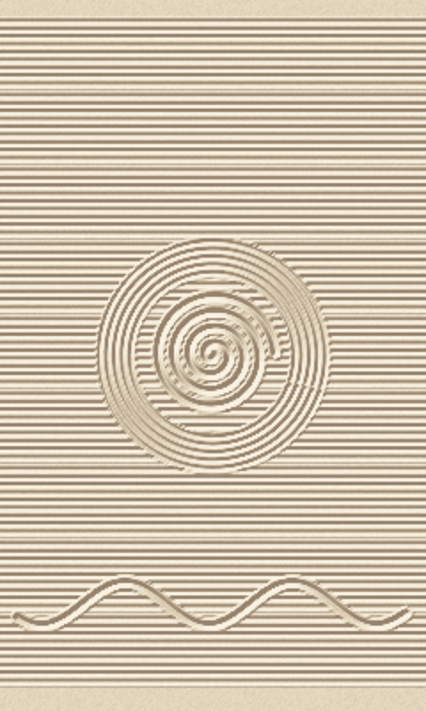

# Sand Art

A calm, modern zen-garden app. Drag a rake through softly lit sand and watch
grooves and ridges form, with shadows that follow the shape of every line.



<sub>Rendered directly by the sand engine.</sub>

## Running it

Requires Node 20+.

```bash
npm install
npm start          # then scan the QR code with Expo Go, or press i / a for a simulator
```

Everything the app uses (Skia, Gesture Handler, Haptics, Expo Router) ships in
Expo Go, so no custom native build is needed yet.

## Checks

```bash
npm test           # unit tests for the sand engine
npm run typecheck
npm run lint
```

## How it works

The garden is a **height field**: one height per cell, 200 cells across.
Level sand is 0, grooves go below and the sand they push aside forms ridges
above.

- `src/garden/rake.ts` carves strokes. Each tine pulls the cells around its
  path towards a groove-and-ridge profile. It eases them towards the profile
  rather than adding to it, so retracing a line keeps it crisp.
- `src/garden/shading.ts` lights the field with a low light from the upper
  left. Slopes facing away fall into shadow and slopes facing the light are
  highlighted. A fixed per-cell grain gives the sand its texture.
- `src/garden/controller.ts` connects touches to the engine and re-lights only
  the changed region, at most once per frame.
- `src/components/SandGarden.tsx` draws the lit pixels as a Skia image.

The engine in `src/garden/` has no React or Skia dependencies and is fully
unit-tested.

See [ROADMAP.md](ROADMAP.md) for what's next.
